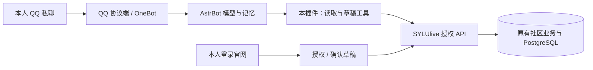

# SYLUlive × AstrBot 授权业务插件

这是个人部署的 AstrBot 插件。聊天、模型、人格、记忆继续由 AstrBot 管理；插件只调用 SYLUlive 授权 API。QQ 可经用户自行配置的 SnowLuma/其他受支持 OneBot 端进入 AstrBot。本插件不分发 QQ 协议端、不登录学校系统、不读取学校密码，不把聊天转发给 Go AI Runtime。



## 首版边界与真实状态

| 能力 | 本实现 |
| --- | --- |
| 标准设备授权、有效教务资格、一账号一个有效助手安装授权 | 已实现，SQLite HTTP 与隔离 PostgreSQL 测试；官方 Go OAuth 客户端互操作测试 |
| 按权限查看正常普通水帖、搜索、评论、楼中楼上下文、本人公开帖子 | 已实现；公开昵称、计数和图片引用见 0.1.6 说明；不增加浏览量；正文内自填个人信息仍可能外发 |
| 食堂榜单、菜品、公开图片理解与当前聊天发送 | 0.1.6 复用 App 公开食堂 API 和 AstrBot 多模态工具链；模型需支持看图，图片有大小与每轮额度限制 |
| 查询活跃版块和内置表情 ID | 已实现；SYLUlive 表情与 QQ 表情不互换 |
| 指定群共享公开读取 | 0.1.5 显式配置后开放帖子、评论、上下文、版块和表情；不开放个人账号操作 |
| 用本人身份发文字帖、文字/表情评论、精确回复评论 | 插件生成不可变草稿，本人在官网逐次确认后同步发布；服务端和本地开关均需开启 |
| 撤销授权、短期 access token、refresh 轮换、重用检测 | 已实现；与 App 登录凭证严格分离 |
| 查询自己的课表、成绩、私信、原始教务资料或替用户登录学校 | **未开放**；API 没有这些 scope，不能通过改提示词或本地配置得到 |
| 自动逛帖、无人确认自动发布、上传图片、点赞、绑定真实 QQ 归属 | **未实现**，不在本首版内 |
| 真实 AstrBot 插件加载、基础 QQ 收发 | 本机 AstrBot 4.29.3 + SnowLuma 2.2.1 已验证；本人授权与公开读取已完成真实 QQ 联调，发布尚未放量 |
| 真实模型选取校园工具并完成业务操作 | 2026-10-30 已验证本轮重新读帖、读取评论及 QQ 回包；验证限于只读，不代表发布、记忆等能力已验收 |

原生 SDK 接口参考 AstrBot 官方源码的 `filter.llm_tool`、`AstrMessageEvent` 与 `StarTools`。本次核对主干 `pyproject.toml` 为 4.29.3；插件兼容范围是待实机验证的声明，不代表范围内每个版本均通过。使用时记录实际固定版本；真实加载不过关不得作为正式可用插件发布。

## 后端和官网准备

先按 [server/README.md](../server/README.md) 与 [web/README.md](../web/README.md) 启动隔离开发环境。后端启动迁移会新增 `integration_*` 表、`refresh_tokens.authenticated_at` 和内容来源列。维护者环境已于 2026-10-30 完成授权与公开读取的生产只读联调；其他安装仍须独立部署并由本人授权。生产迁移、备份、正式放量须走仓库部署流程，不能将一次只读验收当成写入能力已放行。

所有新开关默认关闭。需要同时试验读取、草稿和本人确认发布时：

```dotenv
INTEGRATIONS_ENABLED=true
INTEGRATION_PROPOSALS_ENABLED=true
INTEGRATION_OWNER_PUBLISH_ENABLED=true
INTEGRATION_PUBLIC_ORIGIN=http://127.0.0.1:5173
```

本地网页从仓库根目录启动，**必须显式指向本地 Go**，避免默认代理访问线上：

```powershell
$env:SYLULIVE_API_ORIGIN='http://127.0.0.1:8080'
pnpm dev
```

官网入口 `http://127.0.0.1:5173/web/connected-apps`；个人主页也有“已授权助手”。本地插件的 `server_origin` 配成 **`http://127.0.0.1:5173`**，通过同一个网页代理调用 API。正式环境 API 与官网使用同一个 HTTPS origin，例如 `https://sylulive.online`。客户端拒绝跳转凭证和跨 origin 的验证链接，不能把本地 Go 8080 与网页 5173 混配。

首版只接受当前 `AcademicIdentityBinding` 中 `verification_method=school_profile`、版本 `v1` 或 `undergraduate-preverify-v1`、`verified_at` 非空的身份。`local_declaration`、`legacy_migration`、旧 User 投影不能授权。现有 Web 教务助手的本地身份声明**不自动满足此要求**；未能通过受支持流程补证的真实用户目前不能使用。不要改库伪造真实用户核验；合成数据只用于测试。

## 安装与配置

当前代码在单仓库子目录，不能把本仓库根 URL 当成插件仓库直接导入。

1. 安装用户自己选择的 AstrBot 固定版本和 QQ 协议端，先证明普通 QQ 私聊能收发。
2. 将本目录复制至 AstrBot `data/plugins/astrbot_plugin_sylulive/`，保持 `main.py`、`metadata.yaml` 等文件直接位于该目录。按 AstrBot 插件管理流程安装 `requirements.txt` 并重启/重载插件。
3. 或在本仓库运行 `python scripts/package-astrbot-plugin.py` 得到 `dist/astrbot_plugin_sylulive.zip`，使用支持本地 ZIP 的 AstrBot 管理界面安装。脚本输出 SHA256，固定归档条目顺序、时间与权限；相同源码及 Python/zlib 工具链的输出一致，不受检出文件时间影响。包内只有明确列出的源码/配置/文档，不含 token、缓存、测试数据或协议端。只读安装保持 `allow_proposals=false`。
4. 在插件设置中填写 `server_origin`、消息平台**实例 ID** `owner_platform_id`、本人发送者 ID `owner_sender_id`。QQ 平台填自己的 QQ 号；不能只填通用平台名称 `aiocqhttp` 代替实例 ID。默认不开放群。需要共享公开读取时，将同一平台的群号加入 `public_read_group_ids` 列表，并在 AstrBot 的消息接收白名单中允许该群。
5. 如需草稿，打开插件 `allow_proposals`。在当前 AstrBot 人格/工具集启用本插件的 `sylulive_*` 工具，并使用支持 tool calling 的模型。不要关闭 AstrBot 主模型或把聊天桥接至 Go。

本地发送者白名单只防止本实例误用，不证明真实 QQ 归属。平台约束是“一 SYLUlive 账号一个有效助手安装授权”；手机、电脑、平板 App 登录独立管理，不新增两个登录设备限制。

## 回复展示

0.1.2 通过 AstrBot 原生 `on_llm_request` 为已配置本人私聊追加校园结果展示约定，保留原有人格和原始工具数据。默认用帖子标题、评论内容和本次列表序号交流，不输出 `post_id`、`reply_id`、版本哈希或把数据库编号当楼层。需要继续阅读、引用或生成草稿时，模型仍使用原始准确编号。

例如，日常回复为“《校园话题》的评论里，有同学建议……，另一条回复补充……”。当前请求明确要编号时可显示“帖子 #811、评论 #2013”；明确要原始字段/JSON时再保留技术格式。授权设备代码和审核链接只向本人私聊展示。私聊连接状态优先显示昵称，不显示账号数据库编号。当前展示约定适用于本人私聊与显式获准的公开读取群，不作用于其他会话。

0.1.3 增加当前轮读取约定：查看、查询或总结社区内容时，应重新调用阅读工具；“再总结刚才那篇讨论”也不能只改写历史回复。用户明确说只改写/润色、不要重新读取时才允许基于历史整理。对已知帖子、跟进讨论和常用列表请求，插件记录本轮成功的实际接口读取，缺少所需帖子或评论时将最终回答和本轮保存的助手文本改为明确失败提示，不返回旧总结。该检查覆盖明确编号和常见中文跟进表达，不是任意自然语言的完整意图识别；实测范围为 AstrBot 4.29.3 内置 Agent 的非流式回复，流式已发送内容无法由完成钩子撤回。工具调用仍由 AstrBot 模型安排，不新增一套模型或后台自动读帖服务。

### 0.1.3 变更与验收记录（2026-10-30）

- 修复日常回复直接展示数据库字段的问题：优先使用帖子标题和自然语言，连接状态显示昵称；原始编号和版本仍供工具准确引用。
- 修复跟进总结直接复用历史内容的问题：对已知帖子和常见跟进表达检查本轮实际读取，原帖或所需评论缺失时返回明确失败，并同步本轮保存的助手文本。
- 完整插件测试 **47 项通过**，覆盖本人／他人／群聊隔离、命令不重复触发模型，以及无新读取、只读原帖、完整重读和明确仅改写等分支。这是本机验证结果，不代替新提交的 CI 结论。
- 自行完成真实 QQ 测试：普通聊天约 7 秒回复；原句“把刚才那篇讨论再自然地总结一下”约 28 秒回包。严格限定该轮记录，确认 `sylulive_get_post`、`sylulive_replies` 均返回成功；完整 QQ 回复使用自然语言，没有技术编号。
- 测试未发布帖子或评论；临时测试通道和诊断插件已撤除，原身份、授权与权限配置保留。
- 保留问题：曾有一条消息未回复，具体原因尚未确认；后续测试通过不等于已经根治所有消息丢失。

## 用户实际操作

### 0.1.11 食堂评价展示公开昵称

推荐、图片跟进的事实回包与模型引用评价统一按“公开昵称（日期）：评价内容”展示，并逐条换行。昵称沿用本轮公开详情的 `user_name`，不额外查询私人资料；缺失或空白时用“有同学”，不用账号编号代替，也不猜真实姓名。既有短期引用、图片数量和群／私人权限保持原规则。

### 0.1.10 食堂推荐、追问图片与真实评价

“今天吃什么”仍从真实榜单全量随机抽一家，默认回答店名、已知位置和最多两条最近公开文字评价，不再堆候选数量和名次。抽到饮品会明确说明；没有评价、照片、价格或营业信息时不猜测。可继续说“换一家”。

推荐命令与模型调用共用短期食堂引用：按平台会话、发起人、AstrBot 当前对话 CID 隔离，内存最多256项，只保存店铺编号和时间，30分钟过期，重载丢失。推荐命令首次使用时复用／建立原生对话，不往历史里伪造工具记录。新建对话、另一成员、另一群及明确改聊地图／帖子等不会继承这次推荐；重载后需重新推荐或明确指定店铺。

“有图片吗？给我看看”“这家评价怎么样”等常见跟进会在本轮模型请求前匿名重读同一家店，附上公开资料。图片跟进实际下载图片、复核来源，并交给模型和当前聊天；该轮限制为当前店铺，不能误发旧地图。门面照片、评价配图、审核通过的菜品实拍分别标明来源；没有图、来源变化或投递不确定时明确提示，不自动重发。不保证识别所有自然语言指代，明确换对象时请给店名或先搜索。

模型若把 `<tool_call>` 等调用标记当最终文字输出，本轮完成钩子改用实际读到的店名、位置和评价原文；只有图片投递成功才加发送说明，并同步替换本轮保存的助手文本。照片中的价目仅代表拍摄时标价，不承诺当前价格或营业。

新增 `sylulive_canteen`：读取店铺详情、位置、评分、最近公开评价和图片引用，默认3条、每页最多5条；`next_offset` 非空则未读完。兼容官网 `display_reviews` 的新旧评价，不把两张表的相同编号混为同一评价。`sylulive_public_image(source="canteen")` 使用其中的图片索引，仍每轮最多2张；不能把“有图片记录”说成已经看过或发过。

所有新增查询匿名复用 App 的 `GET /api/canteens/:id`，不扩大私人 scope，不需要重新连接。只投影公开店名、位置、评分、评价文本／公开昵称／时间及照片，不返回用户ID、学号、账号编辑状态、创建人、信用资料或整份详情。公开文字和实际读取图片可能发送给当前 AstrBot 模型；公开群接收范围仍受原白名单约束。

### 0.1.9 每日签到、吃什么与公开校园服务

- `/sylu-eat`、`/吃什么`，或唤醒后的“今天吃什么”：匿名读取实际食堂综合榜，从全部有效店铺中等概率抽一家；多个候选时排除本会话上一次结果。不是只抽榜首几家，不编造营业时间、库存或菜品。空榜／网络失败明确提示。
- `/sylu-map`、`/校园地图`，或唤醒后的“校园地图”：发送与 App／官网同源的实际地图。模型可用 `sylulive_campus_map` 真正看图；固定资产 `/web/assets/campus-map.png` 必须已发布。该原图约4.4MB，专门允许8MiB下载、最长边2400；其他图片仍4MiB／1280，每轮合计最多2张。
- `sylulive_news` 提供资讯搜索、分类和分页，`sylulive_article` 读取正文、发布日期、部门、官方原文与附件引用。正文上限20000字并标记截断；附件没有下载／解析，不能声称已读附件。`sylulive_school_calendar` 复用已发布学校校历，不读取个人课表。
- 所有公开社区、食堂、资讯、地图、学校校历均匿名请求，不携带绑定凭证或 Cookie，未连接／撤权不影响公开查询。社区使用专门的 `/api/integrations/v1/public/community/*` 字段白名单与来源状态检查，不增加浏览量；不能把任意URL或用户私有接口变成公开工具。消息仍只响应部署者允许的平台／私聊／群，不自动扩大接收白名单。
- `/sylu-checkin`、`/签到`，或本人私聊唤醒后的“签到／帮我签到”：执行 SYLUlive 本人每日签到，复用 App 的 Asia/Shanghai 自然日、连续天数、奖励与唯一事实；重复及超时重试不重复领奖。不提供补签、指定用户／日期或定时自动签到。
- `/sylu-checkin-status`、`/签到状态` 查询本人今天是否签到；模型工具 `sylulive_checkin_status` 也只查询，模型没有提交签到的工具。短句入口只匹配完整、已唤醒的消息，不把帖子或引用中的“签到”当指令。
- 签到须本机显式打开 `allow_checkin`，本人重新连接并在官网手动勾选独立 `checkin:write` 权限；默认不勾选，旧授权不扩权。已有连接可以先继续公开查询，需要签到时再本人 `/sylu-disconnect` → `/sylu-connect` 重新授权。其他人／管理员／群不能继承绑定本人身份代签或查询私人签到状态。

签到结果只向本人私聊显示日期、连续天数与本次奖励，不返回账号数据库编号、学号或经验总额。服务端在与撤权一致的锁顺序下重新核对当前授权、身份和scope，签到事实／经验／审计同事务；不依赖帖子草稿或发布开关。生产社区提案和发布可以继续关闭。

### 0.1.7 私有结果逐条审核后分享

跟进总结的已知帖子引用按平台、会话隔离，内存保留最多30分钟，不保存正文、不作为长期记忆。同一会话再次说“刚才那篇讨论”时，插件在本轮模型请求前实际读取原帖／评论并附带受信调用来源与不可信正文标记；没有可定位引用、来源失败时明确拒绝用旧回答冒充新读取。此预读不会伪造模型的 tool_calls，验收同时检查当前请求标记和实际读取结果。私聊也移除通用跨会话发送工具，公开图片本轮按来源去重，投递不确定不自动重复发送。

`allow_private_review` 默认关闭。开启后，获准群里的绑定本人或真实 AstrBot 管理员可使用以下命令；命令不进入群模型，不接受模型代确认。

- `/sylu-review account`：绑定本人请求自己的最小 SYLUlive 账号信息。其他管理员不能继承该绑定。
- `/sylu-review qq QQ号`：查看本机 AstrBot 已保存的该 QQ 当前私聊。本人可请求自己的记录，查看其他会话必须是配置中的可信管理员。不是读取别人电脑或 QQ 客户端的聊天；不存在的会话明确拒绝。
- 机器人将原始审核预览发给**发起人私聊**，标明原目标群和5分钟有效期。QQ 预览最多最近5条纯文字、每条300字，明确截断；不包含工具原文、系统提示或图片，并遮盖常见凭据格式。
- 发起人核对后，只能在私聊逐条发送 `/sylu-share 审核码`，或 `/sylu-cancel 审核码`。群里输入确认、他人拿到审核码、过期、插件重载、移除群、来源变化或授权失效均不能发送。

每次确认重新读取来源、检查权限并比较预览摘要，固定发回原允许群。占用记录在网络发送前保存；重复确认和投递不确定不会自动重发。审核前私有结果不进入群回复或群模型；确认分享后成为群内消息，可能被成员、模型或群记忆保存，无法逆向撤回。

复用 AstrBot 的会话偏好保存最多5项审核元数据（随机码、主体、目标、来源、摘要、到期、状态），不保存正文或凭证；过期记录在下一次操作时清理，插件重载使旧码失效，不宣称自动物理删除。预览发送到 QQ 私聊后的留存遵循 QQ／AstrBot 自身规则。

SYLUlive 当前仅有最小账号信息等已实现 scope；成绩、课表、站内私信等仍未提供授权 API，不能把此审核机制当成新增读取权限。第三方记忆插件私有库不在 QQ 记录工具读取范围。私聊与群的模型工具均移除任意跨会话发送；公开图片用专用工具，私有分享只走上述逐条确认流程。任意额外插件仍需部署者检查其数据注入与外发边界。

### 0.1.6 公开查询与隐私边界

公开读取群内的任何成员都可唤醒机器人查询，无需逐个绑定。其他群、平台和私聊仍按消息来源白名单处理；“内容公开”不等于允许机器人向所有会话主动发送消息。

| 用户请求 | 实际调用与边界 |
| --- | --- |
| 点赞最多／评论最多的帖子 | `sylulive_posts(sort=likes/replies)` 按真实计数排序，同分按 ID 倒序；最新列表保留 `after_id`，排名使用 `next_cursor`，统计变化时不提供快照分页保证 |
| 谁发的、讨论全文 | 详情返回公开昵称、点赞／评论数、最长 10000 字正文和公开图片引用；不返回学号、邮箱、联系方式列、作者内部账号号或完整用户对象 |
| 评论和楼中楼 | 正常评论返回公开昵称与图片引用；删除节点只留墓碑。评论仍分页，`next_after_id != 0` 不能宣称已读完 |
| 食堂榜单／找菜 | `sylulive_canteens` 匿名调用 App 的 `/api/canteens/rankings` 或 `/search`，复用原贝叶斯算法，不携带用户令牌；`rating` 沿用 App 的低分到高分规则 |
| 菜品与实拍 | `sylulive_dishes` 查询已公开的食堂、活跃菜品和审核通过的实拍，结果含真实总数和 `next_offset` |
| 看图／把图发来 | `sylulive_public_image` 按帖子／评论／菜品／食堂门面及序号定位，重新校验可见性；没有菜品实拍不代表没有门面图片。下载后再次核对来源，返回真实图像给 AstrBot 的原生多模态工具链。明确要求发图时仅发送到当前聊天 |

图片每轮最多两张、每张下载上限 4 MiB、解码上限 1600 万像素，缩放至最长边 1280；GIF 只看首帧。超限、文件失败、来源删除或撤权时明确失败，不根据 URL 编造图像内容。实际看图仍需当前 AstrBot 模型启用图像能力；MiMo Flash 支持图片及 Base64 输入，不能因此保证所有模型都支持。无需另建模型或切换 Pro。

公开群在 Agent 检索前设置会话级空知识库，避免回退到部署者全局私人知识库；不改全局知识库、私聊模型、人格或记忆配置。本轮模型工具集仅保留本插件公开工具及原生当前群历史工具，去掉跨会话发送、文件／命令、私人记忆和本人账号工具，即使发送者是机器人管理员也不例外。使用其他记忆插件前仍需核对其注入范围，本插件不能审计任意第三方插件的内部数据处理。

私人账号能力目前仍只有已配置本人私聊的最小账号信息、本人公开帖子和获准的草稿／动作。课表、成绩、站内私信和学校登录没有对应授权 API，**仍不可用**。QQ 已保存会话的有限审核分享见 0.1.7，不开放群模型直接读私聊。管理员不能越过 SYLUlive scope 或替其他人登录，群里也不返回私有结果。后续扩展私有能力必须单独授权并确定私聊投递，不能把“管理员”当作读取所有人数据的权限。

公开正文、昵称和图片可能进入当前聊天、模型和用户部署的记忆；来源删除／撤权可阻断后续工具调用，但不能收回已外发副本。

### 指定群共享公开查询（0.1.5）

维护者先在私聊完成本人官网授权，再在插件 `public_read_group_ids` 中填入需要共享读取的群号。群成员共用这台部署的公开读取授权，不必逐人绑定，也不会因此获得维护者或其他群成员的个人账号权限。群仍按 AstrBot 的唤醒规则触发，可 @ 机器人后说“列出最近的校园帖子”或“看看第一篇的评论”。

群仅能调用公开列表、详情、评论、回复上下文、版块与表情目录的 GET 接口。本人帖子查询、账号资料、草稿、发布结果和所有写入请求均拒绝。`/sylu-status` 在群内通过公开版块接口检查是否可读，不展示账号昵称、授权代码或凭证；连接和断开请维护者在私聊操作。群号默认列表为空，同号的其他平台也不会获得权限。群中的公开文字可能进入群聊天记录、AstrBot、模型和记忆插件；撤销授权不能收回已经发送的数据。

0.1.4 将 `sylulive_replies` 调整为先读取原帖详情，再读取一页评论，返回 `data.post` 和原有 `data.items`。这样模型选择评论工具即可获得本轮完整的原帖上下文；任一读取失败都不返回拼接的旧数据。两次请求仍分别校验同一授权与当前可见性，不增加真人浏览量。此变更不扩大 scope 或发布权限。

1. 在指定平台本人私聊发送 **`/sylu-connect`**。插件直接返回设备代码及官网链接，不依赖模型猜测登录操作。
2. 自己登录官网，核对账号、设备代码与自报安装名称，勾选允许的范围。提案权限默认不勾选。已有连接时，明确同意替换旧连接。
3. 返回私聊发送 **`/sylu-status`**。此命令只轮询一次；未批准/轮询过快会明确提示，稍后再查。不能只看到官网“已授权”就认为插件已经取得凭证。
4. 先让助手“列出 SYLUlive 最近的帖子”，再指定帖子读取评论。也可通过 AstrBot 工具调试界面检查 `sylulive_posts` / `sylulive_get_post` 的真实结果，区分模型未选工具与接口不可用。
5. 需要发布时，助手先读取来源版本，再调用 `sylulive_draft_reply` 或 `sylulive_draft_post`。它返回 `action_id` 和 `review_uri`；此时**尚未发布**。
6. 自己打开官方审核页，核对全文、表情、原帖与目标账号，勾选后点“确认并发布”。草稿保留72小时，一次预览的确认窗口5分钟；超时或另一页面刷新 nonce 后，重新加载再核对。
7. 原帖正文、目标回复或治理状态变化会阻止发布，要求重新生成草稿；浏览/点赞计数变化不会使草稿失效。拒绝草稿也不会发布。
8. 发布状态只认服务端 `state=published` 及返回的真实 `post_id` / `reply_id`。重复确认只返回同一个结果。帖子/评论显式携带来源，正文保留旧客户端也能看到的“助手代发”提示，不发放经验奖励。评论和站内提醒在同一事务提交，精确回复通知对应作者；自回复不提醒，重复确认不重复提醒。外部推送提交后复用现有设置和尽力投递流程，不承诺外部必达。
9. 断开发送 **`/sylu-disconnect`**，或在官网连接管理撤销。网络错误时不能宣称已撤权，应去官网检查。教务换绑/解绑、注销、撤销协议会同步使授权和待发布草稿失效。

以上英文命令为主入口，旧中文词保留为兼容别名。命令处理后终止事件传播，不再让默认模型追加第二条回答。普通聊天和业务工具调用仍由 AstrBot 模型处理。

早期 0.1.1 验证时，校园业务后端尚未启动，连接命令返回服务不可用。后续已完成真实本人官网授权、连接状态和 0.1.3 只读联调，结果见上方验收记录。其他环境仍须按实际接口响应判断，不能仅凭插件加载或合成模型测试宣称已连接。

官网授权和确认发布要求10分钟内真实重新登录。App refresh 或重新生成 JWT 不延长该证明；老版本登录记录没有 `authenticated_at` 时需重新登录。撤销助手不要求10分钟内登录，避免延误止损。

## 凭证与数据

服务端只存 token 摘要；10分钟 access token、7天闲置 refresh token、30天绝对期限。 已轮换的旧 refresh 即使超过原7天期限，保留期内重放仍会撤销同一授权；替换前的旧授权不会影响新连接。插件会隔离旧请求的成功和错误响应，避免清除新连接或新轮换的凭证。插件使用 OS 凭据库，仅接受 Windows、macOS、SecretService/KWallet 内置后端；不使用第三方明文 keyring。无可用凭据库时只存进程内存，命令会提示重启需重新授权。不要把凭证复制进人格、聊天、模型参数、共享配置或日志。

本插件不实现第二套记忆。读取内容可能被 AstrBot、用户所选模型与记忆插件保存；官网撤权可阻断后续请求及发布，无法逆向撤回已交给模型的内容。具体保存/删除见仓库隐私台账及你部署的 AstrBot/模型设置。

## 验证与排错

```powershell
cd server
$env:GOMAXPROCS='2'
go test -p 1 ./internal/handlers ./internal/services -run TestIntegration -count=1
```

真实 PostgreSQL 行锁测试只接受本机专用可丢弃库，并为每个测试新建、清理独立 schema：

```powershell
$env:INTEGRATION_TEST_POSTGRES_DSN='host=127.0.0.1 port=55439 user=YOUR_LOCAL_TEST_USER dbname=sylulive_integration_test sslmode=disable'
go test -p 1 ./internal/services -run TestIntegration -count=1
```

在仓库根目录执行插件与官网定向测试：

```powershell
python -m pip install -r astrbot_plugin_sylulive/requirements.txt pytest pytest-asyncio docstring-parser
python -m pytest -q astrbot_plugin_sylulive/tests
$env:SYLULIVE_API_ORIGIN='http://127.0.0.1:8080'
pnpm exec playwright test web/e2e/connected-apps.spec.ts
```

`test_astrbot_dispatch.py` 需要真实 AstrBot SDK：在隔离环境安装固定 `astrbot==4.29.3` 后运行，未安装时明确跳过。该测试通过 AstrBot 的真实 `ProcessStage` / `StarRequestSubStage` 检查命令成功、失败和拒绝访问路径不会落入第二次模型回复，同时核对英文命令注册。离线事件替身不覆盖这一边界，不能替代此项检查。SDK 导入测试应在隔离目录运行并设置 `ASTRBOT_ROOT`，避免向工作目录写入运行数据。

测试不访问真实 QQ、不调用付费模型、不读取真实学校资料。发布前还必须记录：固定 AstrBot 版本插件加载、本人/他人/群聊隔离、真实 QQ 收发、模型选工具、退出重连和真实账号教务资格覆盖情况。后端 404 先检查开关与服务版本；403 检查资格/scope/近期登录；草稿成功而未发布先检查官网确认和发布开关，不通过绕过授权解决。

参考：[AstrBot 原生工具注册](https://github.com/AstrBotDevs/AstrBot/blob/master/astrbot/core/star/register/star_handler.py)、[AstrMessageEvent](https://github.com/AstrBotDevs/AstrBot/blob/master/astrbot/core/platform/astr_message_event.py)、[RFC 8628](https://www.rfc-editor.org/rfc/rfc8628)、[RFC 7009](https://www.rfc-editor.org/rfc/rfc7009)、[OAuth 安全实践 RFC 9700](https://www.rfc-editor.org/rfc/rfc9700)。
