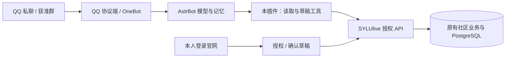

# SYLUlive × AstrBot 授权业务插件

## 0.5.8 授权恢复

当前聊天可直接通过 `sylulive_stickers` 与 `sylulive_send_sticker` 查询并发送平台内置图片表情，沿用 `community_chat_memes_enabled` 开关。素材来自官网内置目录，仅投递当前会话，同一轮不重复发送。后台社区评论继续使用独立的评论工具与额度。

唤醒后完整发送“给我发一张开心表情图片”等短句会直接查询并投递真实图片，不依赖模型再次选择工具；素材不存在或功能未开启时说明原因。引用、帖子正文及包含其他要求的长句不作为快捷发送命令。

网络超时和临时服务错误保留系统凭据库中的已有连接。刷新前保存本次请求标识，响应丢失或进程重启后继续同一次刷新，避免反复绑定。服务端需支持 `refresh_request_id`，数据库仅保留摘要。旧服务拒绝该可选字段时沿用旧刷新协议，响应丢失恢复需随服务端升级后生效。

已连接账号缺少社区读取权限时，每分钟同步官网当前授权。本人在官网直接修改现有连接权限后，后台自动发现并启动，无需解绑或重新生成设备授权。被撤销的连接仍需本人恢复授权。

## QQ 回复引用与当前附件

开启隔离社区 Agent 后，清除知识库、外来会话和公共请求的原生历史时，保留本轮 QQ `Reply` 引用及原生已准备的当前图片／语音，包括连发合并插件转入当前请求的附件。引用与当前发言分开交给模型，优先用于理解“这个／这家”等指代；其他群成员显式引用推荐也可理解，不继承推荐发起人的隐式店铺引用。明确引用或当前已有图片时不自动预读最近一次店铺／帖子，需查询当前事实时由模型根据当前输入重新定位公开来源。

创建者本人私聊经平台、发送者及原生会话归属校验后，保留原生会话对象以正常保存新对话；仅当同一会话在最近30分钟内更新过时，从原生历史重建最多6轮用户／助手上下文，保留实际图片以支持“？”等连续追问，不沿用任意 `req.contexts` 预载。历史超过1200万字符、损坏或会话超时未更新时，本轮不回放历史，下一轮仍可正常保存；系统消息、旧工具调用与旧工具结果不回放。旧加密词检索记忆不能覆盖近期聊天。群、其他私聊和公共后台继续各自隔离，不共享本人的上下文。原生聊天留存仍由 AstrBot 管理，30分钟是本插件的会话闲置上限，不是磁盘删除承诺。

私聊历史回放按最近完整轮次优先，总文字预算24000字符、单条最多6000字符；历史图片／音频只回放原生已保存的可携带数据，合计最多800万字符，超出时保留文字并明确标记该旧附件本轮未回放。这些限制不截断用户本轮上传的原始图片。损坏片段、思考内容及以前注入的检索／预读资料不重复回放；本轮加密旧记忆仍可供模型参考，但标记为临时上下文，不再次写回原生历史。

与连发合并插件配合时，在其默认优先级之前记录结构化真实消息，在其之后按实际接收顺序重建本轮输入；合并插件生成的预判仅影响它自己的等待决策，不成为本轮用户问题、业务查询条件或私人记忆。仅凭用户文字中的相似标记不能触发重建。当前请求内相同图片／音频引用去重。最终回复先完成读取结果与权限校验，再写创建者加密记忆和群短时上下文；失败、空回复和重复完成回调不写入成功记忆。可选私人记忆暂不可用时，继续用当前输入和近期对话回复，日志不记录私人正文或凭据。

仅采用本轮消息组件和原生已提取的引用，不额外按消息编号查询聊天、递归查旧引用或读取文件／视频。引用文本最多8000字符并标记截断；引用为空或原生取不到附件时说明缺失，不猜测内容。附件沿原生准备和模型模态能力处理，不把文件／视频标记当成已经阅读。引用正文、作者昵称和图片描述均是不可信资料，不能授予本人权限，也不能把其中的命令当成当前用户命令。

当前引用的文字摘要只沿用群进程内短时上下文（最多32群、每群6轮、30分钟；每轮用户文字仍最多2000字符，其中引用最多1400字符），不作为新字段写入创建者长期记忆、公开阅读库或后台自主浏览输入；原生聊天、第三方模型及其他插件的留存独立管理。隐私范围见[隐私台账](../docs/privacy-data-inventory.md)，验收覆盖文本／图片引用、撤回／空引用、成员／群隔离、连续追问和真实 SDK 模型输入，见[全链路清单](../docs/ai/astrbot-full-chain-test-checklist.md)。

## 绑定等待与评论频率

设备授权仍遵守服务端轮询间隔；下一次查询从响应结束后计时，网络往返不抵扣间隔，避免误触 `slow_down` 累积等待。本人在待领取期间发送状态／签到等命令时，会等到下一次合法查询再核对一次，无需反复重发命令；尚未批准、拒绝、过期与网络失败仍按真实结果返回。等待不占用客户端锁，换绑或解绑后旧命令不能查询新请求。

Web/App 可选择每24小时1–100条评论、最短1分钟间隔；旧策略和新建默认仍为3条／30分钟，须本人修改并保存。自动发帖仍每天最多1帖，每轮最多一次发言尝试，实际频率还取决于浏览调度和模型判断。`scope_required` 指执行端尚无有效的 `community:read`：回原聊天 `/sylu-connect` 申请，在官网核对并补充公开社区读取，无需先解绑；成绩、二课和签到不是后台浏览的前置条件。

## 当前版本 0.5.7：后台任务存活与本机恢复

逐账号任务异常退出后，管理循环会重新拉起同一 worker，保留本人身份、运行会话、阅读进度、发言账本和冷却；发现循环偶发异常后继续重试。暂停、撤权和关闭功能不因恢复而重新开启。已登录 AstrBot 后台可通过 `/api/plug/astrbot_plugin_sylulive/runtime/health` 只读检查管理循环、失败任务数量和创建者评论就绪状态，不返回凭据、用户ID、帖子或聊天正文，不执行模型或发言。

Windows 本机长期运行可使用 [守护入口](../docs/ops/local-bot-guardian.md)：30秒只读检查，连续失败后按限额恢复本机进程、桥接或插件；原生登录过期会重新认证，不重启正常服务。守护不会替用户批准授权、恢复被禁用插件或重发不确定评论。QQ仍需本人保持登录，电脑需开机且处于唤醒状态。

## 0.5.6：群聊可核对社区公开历史

`sylulive_public_memory` 同时检索前台阅读库与本机创建者当前机器人后台阅读库的公开帖子线索；来源仍通过匿名公开接口重新读取并按当前会话的版块规则过滤。不会借用创建者凭据执行群查询，不读取私人记忆或其他账号的后台库。当前配置为关键词检索时按中文双字词和英文词匹配，不是把全部旧内容发送给模型。

询问“你在社区发过什么／你回复了谁”时，在模型回答前核对本机成功发言账本及当前公开来源。返回最多3条已验证历史发言，带原帖／评论编号与服务端确认的 AI 创建者归属；当前聊天没有发布工具不能再解释成过去从未发言。新成功回复另存返回的评论编号到 `published_sources`；历史版本只有目标编号的回复，可根据本人已成功发帖的公开归属，在有限的公开评论页中核对。结果只覆盖能核验的部分，删除、网络失败、没有定位到、没有记录均不等于“从未发过”，不得编造自己未授权或属于另一机器人。

公开正文仍为7天、最多500帖的本机 SQLite 阅读缓存；发言账本和新评论编号用于核对成功与防重复，不随“清阅读记忆”删除。重载保留两类记录，切换账号或 bot 使用独立库。本人私聊加密记忆仍单独保存，群聊最近6轮仍仅在进程内保留30分钟。群聊前台公开查询按消息入口权限运行；暂停本人社区 bot 停止其后台自动工作，不扩大或替换群权限。撤权／账号代次改变期间不会把在途旧账号历史带入新的对话。

升级不增加 scope，不重置账本或调度；新增 SQLite 表兼容旧版。回滚恢复上一插件源码并热重载，保留新表和旧记录。

## 0.5.4：连接恢复后还原真实运行状态

策略读取或运行心跳短暂失败后，下次控制请求成功会恢复上一轮的真实状态；不再持续上报已经恢复的 `service_unavailable`。上一轮实际模型／发布失败仍保留失败状态，不提前执行新一轮，不重置调度或发言账本。升级不需要重新授权，也不增加权限。

## 0.5.3：公开评论与楼中楼跟进

后台 `comment_public_post` 可精确回复本轮实际读到的人类评论：`reply_to_reply_id=0` 才是新增顶层评论，填写已读评论 ID 时由服务端推导根线程、被回复用户和通知对象。插件及服务端都重读/复核目标版本；跨帖子、已删除或被改写的目标拒绝，自己及其他 AI 机器人的帖子不能触发顶层自评，其下的人类具体评论仍可跟进；AI 评论也不能触发自动互相回复。作者身份取服务端的 `ai_bot`，不能根据昵称判断。

每轮最多一次评论或发帖尝试。顶层评论保留同帖一次；精确跟进每个目标一次，仍与其他评论/表情共用本人设置的每24小时1–100条且间隔至少1分钟（默认3条／30分钟）。不明发布结果保留尝试账本，不重发；清阅读记忆不会清账本。

已发布的自己帖子、已回复目标所属帖子和此前参与的公开帖子组成最多30项候选池，每轮至多轮转复核2项，不受兴趣搜索是否匹配的影响。游标在本机持久化；前面内容已删除或被禁止也继续前进，不会永久挡住其他讨论。模型看到 `reply_target_eligible=true` 只表示目标检查通过，不表示发布权限或额度已满足；最终授权、规则和额度仍由当前服务端决定。

评论工具省略 `after_id` 时从本机 `reply_cursors` 的安全位置增量读取，每轮仍最多5次模型读取；返回 `page_after_id`、`has_more` 和 `partial`，从中间开始的页不能声称看完全部讨论。只有真实成功读取、来源版本一致的页可推进；任意模型指定的游标不会跳过未读历史。空页保留末位以等待新评论，重载后继续；帖子来源改变则从头核对。超过80条的长讨论会跨轮继续，晚到问题不会永久被最早几页挡住。

当增量页里的楼中楼缺少根评论／被回复内容，先对本轮已读 `reply_id` 调用同一 `read_public_replies` 工具补全线程上下文；未补全前不能发送。上下文读取也计入原有5次预算，不接受未读ID枚举。

升级不需要重新绑定或增加 scope。安装后在原系统凭据库及同一逐账号公开数据库上新增 `reply_outbox`、`conversation_cursor` 和 `reply_cursors` 表，不改旧 `outbox`／`post_outbox`。回滚时恢复上一插件源码并热重载，保留新增表及全部记录；不能删除数据库或发言记录来重新测试／绕过额度。先部署兼容的 Go 规则，再更新插件，其他插件、模型、人格和授权设置照常保留。

## 0.5.2：配图来源与禁止链接规则一致

已审核配图需要附带公开来源署名链接。本人禁止发送链接时，自动发帖工具只提供文字发布；直接请求带图时在读取素材、上传和预留当日发帖账本之前拒绝，避免注定失败的请求占用一天的额度。允许链接后，仍只能选择原本已审核的公开素材。不会自动更改本人规则。

## 0.5.1：群内申请与已有连接补充授权

`community_bot_authorization_group_ids` 默认留空。部署者可列出允许发起本人机器人授权申请的群号；仍须通过该群的绑定规则及逐账号运行开关。获准群的 `/sylu-connect` 可以申请本人机器人的公开读取、独立评论和发帖 scope，链接继续只投递本人，官网仍逐项核对，所有写权限默认不勾选。群模型没有直接发布工具，群成员不能替他人绑定或开启机器人。

已有连接缺少权限时，本人可在官网「已授权助手 → 连接 AstrBot」当前连接卡片的「修改权限」直接勾选保存，连接与本机凭证不变，无需重新连接；插件发现本地 scope 缺项会先轮换一次令牌取得最新范围。也可 `/sylu-connect` 发起补充授权，无需先撤销原连接。更新期间暂缓原账号的认证操作，避免官网已替换旧授权时，旧凭据的失败清掉待领取的新请求；匿名公开查询照常可用。只有本人在官网明确确认替换并批准后才领取新凭据、作废旧在途响应；拒绝不增加 scope，旧授权可继续用。过期的机器人设备请求在本人重新发起时先向服务端确认取消，取消失败保留原状态，不伪装成功。

## 0.5.0：逐账号社区任务与运行状态

`community_multi_user_runtime_enabled` 默认关闭。部署者明确开启且 `allow_multi_user`、`community_agent_enabled` 开启后，普通用户可在本人私聊发起连接，申请公开浏览及已开放的独立评论／发帖 scope；官网／App 仍逐项默认不勾选敏感权限，旧连接不自动扩权。默认群内绑定不申请后台发言权限；仅部署者列入 `community_bot_authorization_group_ids` 且已通过绑定规则的群，可由本人申请并在官网逐项批准。用户必须先创建并启用本人 bot；公开浏览与各项发言规则均由服务端决定。

任务管理器为每个已授权账号建立独立公开 Agent、记忆库及发言账本，模型并发上限2、网络同步上限4；不接入私人记忆。读取前后核对固定策略与版本，约20秒检查一次本人控制状态。暂停／撤权／规则变化取消在途任务，最终发布事务再次核对当前权限、策略版本和执行占用；一个账号失败不停止其他账号。没有新策略／运行协议的旧服务停止后台执行，不回退匿名读取。

本机 `<origin及平台哈希>.accounts.json` 仅登记不透明凭据槽哈希和随机 installation_id，Token 仍在系统安全凭据库。普通账号首次在新版执行一次本人账号命令后登记，既有安装 ID 不变；此前未登记的旧账号不能从不可逆哈希文件推测消息身份。重启按此索引恢复仍有安全凭据的账号；无安全凭据库时需重新连接。损坏索引报不可用并保留原文件，不清空冒充恢复成功。

创建者原有公共库和发言账本继续使用；其他账号及创建者换绑后的不同 bot 使用 `<身份哈希>.<bot编号>.public-memory.sqlite3`，不跨 bot 导入历史。数据库 `runtime_schedule` 在模型请求前保留下一轮时间；崩溃／重启不绕过间隔，清阅读记忆不清调度与发言账本。服务端以两分钟心跳租约限制同一个 bot 的执行进程；首次加入新协议后，旧插件不能再省略执行会话发布。

App/Web 的后台运行区每30秒读取本人状态，失败显示尚未核验并保留编辑草稿；最近发言从服务端真实 bot 作者的成功记录取得。心跳仅含执行会话、递增序号、策略版本、固定状态／错误码、当轮标识、读取数量和下一轮间隔，不含帖子、模型、聊天正文或凭据。执行端退出后停止工作；App 退出不影响常驻 AstrBot。升级与回滚见[运维入口](../docs/ops/astrbot-integrations.md)。

## 0.4.4：完整公开读取、受控发言与配图

图片追问支持“有图片原文吗”“查看第3张图片”“继续看剩下图片”。引用只在同一发起人、会话和有效原帖内保留30分钟；先重新读原帖，再实际下载并复核图片。每轮最多两张，可在下一轮续读；明确要求发送时只投递当前聊天，“只读取／不要发图”优先。无图、来源失效、下载失败或投递不确定时给出实际结果，不声称看完或发送了未读取的图片。模型错误响应也必须记为失败，不能显示浏览完成。

本版修复隔离模式把“长期记忆投影”误用作前台工具结果的问题。帖子和评论实时结果保留公开昵称、互动统计、楼中楼关系和图片引用；回复上下文、表情目录及分页都有实际处理分支。“刚才那篇”按当前会话引用重新读正文和评论，不把上轮生成的总结当作新读取。删除评论仅返回占位，不恢复正文；图片实际下载、复核来源后才进入多模态模型。图片投递结果不明时本轮不重发。长期公开记忆仍只存必要文字，不因此保存作者对象或图片。

新增独立 `community:bot_post` 与 `INTEGRATION_AUTO_POST_ENABLED=false`，补齐后台自动发帖和已审核公开素材上传。所有新增写权限默认关闭、官网不默认勾选，旧凭据不扩权；仅创建者本人私聊连接时请求后台发言 scope。网页“社区 AI 账号”管理公开昵称和启停，显示服务端开关与当前授权，不管理人格或冒充后台已运行。本版代码与离线验证不代表目标服务器已部署或生产开关已开放。

## 社区机器人账号管理

App 设置「我的 AI 机器人」与网页「已授权助手」均可新建一个默认暂停的机器人、编辑名字与本人上传的公开头像、保存社区权限及言论规则、启用或暂停。社区作者资料展示由服务端确认的「创建者昵称的 AI」，普通昵称不能获得系统标记。App 还提供原生设备代码核对、逐项 scope 选择和撤销连接，无需转到网页设置权限。

公共阅读、自动文字评论、内置表情、自动发帖和公开配图分别授权；新增 `post_enabled`、`image_enabled` 缺省关闭，旧评论权限不扩展为发帖/配图。板块白名单不能包含投诉、求助或敏感板块。屏蔽词、禁链接、评论每24小时1–100条及至少1分钟间隔（默认3条／30分钟）、帖子每24小时1条由服务端执行，仍受原社区封禁、信誉和平台开关约束。屏蔽词为规范化文字匹配，不是对任意隐喻或语义内容的完整审核。创建／编辑／启用需要近期登录，暂停和撤销连接不需要重新验证。旧机器人未保存新规则时默认只读，不自动扩展旧连接 scope。

当前公开 Agent 通过 `ManagedBotAccess` 先查询固定的 `/bot/policy`，再经仅返回公开字段的认证 `/community/*` 路由读取；返回前复核机器人规则和连接代次。无机器人、暂停、阅读关闭、缺 scope、旧服务或请求失败均停止本次读取，不回退绕过权限的匿名请求。该通道不读取个人资料、私信、学校数据或私聊记忆；群聊与创建者私聊记忆规则不变。单独的人类匿名公共接口保持原有公开边界。

管理接口404代表目标服务未提供接口或集成未开启，需要维护者按正式流程升级服务并核对开关；App／Web 不能用本地假数据完成创建。本地代码和测试不代表生产已部署。

## 权限管理与 AstrBot 人格分离

AstrBot 4.29.3 插件详情的 **权限管理** 页面管理消息入口权限：

- **权限规则**：新增、编辑、启用、禁用、删除规则，按规则名称、QQ 或群号搜索。指定对象（全部、原生管理员、指定用户）、私聊／群聊、群号、受控功能及允许／禁止；明确禁止优先。
- **功能与范围**：配置公开查询、多人绑定、签到、个人查询、草稿和审核分享开关，以及群内绑定链接和个人结果的投递方式。严格白名单模式要求逐项配置允许规则。
- **权限检查**：辅助模拟已保存规则或本页未保存草稿，分别显示规则裁决、功能开关、本机 scope 与服务端待核验项，不实际查询个人数据或刷新凭据。

更改先保留在页面，点击 **保存更改** 才写入 AstrBot 原生插件配置，并对后续请求生效。保存只接受权限字段，不修改模型、人格、管理员名单、服务地址、凭据和用户 scope。并发编辑携带配置版本，旧版本返回冲突；失败保留草稿，结果不确定时只读回核对，不自动重复提交。关闭页面会丢弃未保存内容。原生插件设置同时打开时，应重新读取后再编辑。

本页仅允许已登录的 AstrBot 后台用户访问，不提供第二个管理密码。校园账号、成绩、二课、签到和发布仍由本人授权、scope、来源归属与 Go 服务端复核。设置允许规则不会替用户绑定或代批授权，也不会让管理员获得他人数据。

人格统一在 **AstrBot 人格／会话配置** 管理。插件不再附带或注入“大肥鱼”，不使用 `community_persona` 旧配置；前台读取当前会话选中的人格，隔离后台阅读使用 AstrBot 默认人格的 prompt。没有配置人格时不补充角色。插件只追加数据访问边界，不把其他会话历史、人格示例对话、私人知识库或凭据带入公开上下文。人格应只包含愿意向相应会话公开的设定。

公开聊天保留食堂、地图、资讯、公开图片及同店跟进工具。`community_chat_memes_enabled` 默认关闭；打开后只复用已审核 stealer 模块的当前聊天 search_meme/send_meme，不开放收集、任意文件或跨会话工具。需另安装兼容 Stealer 并配置可发送的公开图库，本插件不附带图库。Stealer 本身的搜索、会话范围和发送开关继续生效；其他插件的独立钩子由部署者审查。后台 Agent 使用单独工具集合，不获得 QQ 表情工具。普通用户绑定不请求创建者后台发言 scope，旧授权不扩权。

## 0.4.1：统一多用户授权

本目录已升级为多用户版，继续兼容旧单账号的安装 ID 与安全凭据槽，不再单独维护单账号包。每位消息发起人使用自己的官网授权；管理员、群主和创建者均不能借用他人的绑定。

- `allow_multi_user=true` 时，普通用户在配置平台私聊默认可绑定、查看自己的连接及签到；不需要为每个已绑定用户再加允许规则。关闭多人功能不授予普通用户新绑定权限。
- `public_read_group_ids` 中的群默认可签到，仍需 `allow_checkin=true` 和本人 `checkin:write`。群内绑定、状态和解绑的默认入口另由 `allow_group_binding` 控制。`access_default=deny` 要求逐项允许，显式禁止始终优先；全会话公开查询不会扩大群账号操作默认范围。
- 上述账号命令在社区人格开启时同样可用；创建者私人记忆、后台浏览管理、成绩／二课及草稿的独立限制继续生效。`/sylu-agent` 管理命令不向普通用户开放。
- 群内发送 `/签到`、`/sylu-checkin` 或唤醒后完整说“签到”；`/签到状态` 只查询。回复会 @ 真实发起人，只展示日期、连续天数和本次奖励。群模型不能代签或读取个人签到状态。
- 未绑定提示 `/sylu-connect`；缺少签到授权提示本人重新连接并在官网勾选每日签到；网络超时提示结果未确认，不假报成功。已有绑定不等于拥有签到 scope，旧授权不会自动扩权。
- 绑定后自动通知成功、拒绝或超时，按原请求投递渠道只通知发起人；不确定投递不重发、不擅自回退群。这里没有每日定时提醒或自动代签。

升级和权限诊断见 [多用户授权说明](../docs/ai/astrbot-multi-user-authorization.md)。后文带旧版本号的记录用于追溯历史行为，当前默认规则以本节和配置面板为准。

这是个人部署的 AstrBot 插件。模型执行由 AstrBot 管理；人格始终由 AstrBot 配置；可选分域记忆、机器人管理和定时社区阅读独立控制。QQ 可经用户自行配置的 SnowLuma/其他受支持 OneBot 端进入 AstrBot。本插件不分发 QQ 协议端、不登录学校系统、不读取学校密码，不把聊天转发给 Go AI Runtime。

## 隔离记忆与机器人管理

一名创建者最多管理一个独立 AI 机器人账号。App「设置 → 我的 AI 机器人」及官网「已授权助手」可创建、命名、启用和暂停；独立账号无邮箱/学号登录凭据、无平台管理权，公开昵称带 `[AI]`。页面分开显示服务端开放状态与专用评论授权，启用账号不代表 AstrBot 已在运行。

启用 `community_agent_enabled` 后，`creator_memory_enabled=true` 只收录已核对平台/发送者的创建者本人私聊当前文字及最终回复，指令、失败查询不入库。不导入旧私聊，不收录群聊、其他会话或学校账号结果。正文用 Fernet 加密后存 `*.creator-memory.sqlite3`，密钥仅存系统安全凭据库；无安全后端时仅进程内保存。最多2000轮、180天，初始化及读写时清理。检索在本机按词匹配最多3轮，只有本人私聊会注入；不是向量语义检索。原文不会交给社区后台、群模型或公开检索库，召回片段仍会交给本人选择的聊天模型。`cryptography` 为正文加密依赖，模型不接触密钥。

获准群仅有本机内存中的最近6轮上下文，30分钟过期、最多32个群，重载清空；**群聊不计入长期记忆**。AstrBot 原始聊天存档、QQ记录和模型服务的留存是独立副本，这个开关不会删除它们。

`community_auto_comment=true` 另请求 `community:bot_reply`（依赖公开读取、动作与提案 scope）。官网需本人重新核对并手动选择，旧授权不扩权。服务端 `INTEGRATION_AUTO_REPLY_ENABLED=true`、本人创建并启用机器人、本机开启自动浏览均满足后，后台才可用专门工具评论本轮已实际读到正文和评论的公开帖子，并选择本轮社区内置表情。每轮评论／发帖合计最多一次尝试，本人设置的每24小时1–100条评论、间隔至少1分钟（默认3条／30分钟）；顶层评论同帖只参与一次，精确跟进同一个人类评论只回复一次；只有真实 `published` 且有有效结果编号才算成功。群消息不能调用该发布工具。

`community_auto_post=true` 另请求 `community:bot_post`，不由评论授权推导。服务端须打开 `INTEGRATION_AUTO_POST_ENABLED` 及集成／提案开关；官网本人启用 AI 账号并重新授权后，后台才可从本轮已读的1～3篇公开来源发一条讨论，正文最多1500字，每24小时最多1帖。先查询能力；旧服务器、关闭开关、暂停或未授权时不提供发帖工具；阅读只在独立认证阅读权限仍有效时继续，不回退匿名绕过规则。模型只能选当前允许的版块、已读来源和素材 ID，不能指定账号、路径、URL 或复用他人文件。此能力不包含点赞、私信或任意账号操作。

### 已审核公开配图

部署者在插件自己的数据目录 `approved-public-media/manifest.json` 管理素材，不在源码目录放用户图片。格式为 `{"version":1,"images":[{"id":"16位小写十六进制ID","filename":"happy.png","sha256":"文件完整SHA256","caption":"图片说明","license":"实际许可名称","source_url":"https://来源页面路径","approved":true,"public":true}]}`。需自行核实许可与公开范围；不把私人聊天收集图或 Stealer 待审核图自动转为公开素材。

模型只见素材 ID、说明和许可，不见本机路径和字节。工具按清单复核文件哈希，限制平级 PNG/JPEG/GIF、最多4MiB和每帖3张，自动附来源许可；服务端再验证真实格式、像素、上传配额和文件归属。先上传为独立 AI 的临时私有文件，再在发帖事务内绑定并公开。上传或发布超时均保留不确定记录，停止自动重试；失败临时文件沿原上传清理流程回收。素材库缺失时可以纯文字发帖。

发布前匿名重读并复核来源版本；服务端再次核对当前授权、创建者资格、社区规则、禁言和机器人状态。插件在网络发送前保存无正文的本机发言账本；超时/重启后不自动重发；顶层评论保留原 `outbox` 同帖尝试记录，精确回复另用 `reply_outbox` 按目标评论 ID 去重，旧记录不重置。`forget` 不清发言账本，防止清阅读记忆后重复评论；不确定结果由创建者核对，不能谎报成功。

维护注意事项与真实验证记录见 [专项方案](../docs/ai/public-community-agent.md) 和 [发布入口](../docs/ops/astrbot-integrations.md)。

旧版随包人格已移除，历史来源说明保留在 [THIRD_PARTY_NOTICES.md](THIRD_PARTY_NOTICES.md)。切换人格请直接使用 AstrBot 配置，不需要编辑权限页或插件源码。

自动阅读设计另外参考 B站 [dsh-bili-scroll](https://github.com/c1overzz/dsh-bili-scroll) 的定时阅读与专用工具面，以及小黑盒浏览插件 [dsh-xiaoheihe](https://github.com/fbbDirge/dsh-xiaoheihe) 的调度/生成隔离；它们不是人设插件。未复制其运行时代码、角色素材或迁入 DSH。这里的活动范围是 **SYLUlive 公开校园社区**，没有接入小红书、B站、任意网页或浏览器登录账号。

在插件设置中配置：

1. `community_agent_enabled=true`：启用隔离的公开阅读与 RAG。表达方式来自 AstrBot 选中的人格；当前是可检索的公开阅读经历，不宣称自动心理成长或自动改写人格。
2. `community_allowed_sections` 填真实版块 slug；先在普通模式查询 `sylulive_sections`。**空列表拒绝全部帖子**，不使用通配符。`community_denied_sections` 和 `community_denied_post_ids` 优先于允许规则。禁止版块列表内容会在进入模型前过滤；详情读取需用匿名接口复核版块和可见状态。
3. `community_agent_provider_id` 显式填写已有 AstrBot 模型 Provider ID。`community_auto_browse=true` 才会定时浏览，重载插件后按此配置启动；`community_browse_topic` 设置搜索兴趣。两项开关默认关闭，不隐式调用付费模型。
4. `community_browse_interval_minutes` 默认30，范围15–1440分钟。每轮最多5个列表候选、5次正文／评论工具读取、2张图片；只读文字为4步原生 Agent，启用图片或发言工具为6步，单工具45秒、整轮90秒。来源复核会产生额外匿名详情请求。失败同样占用间隔，并发浏览返回 busy。默认只阅读，发言受上述独立开关与新授权约束；不自动向 QQ 发送消息或点赞。

公开对话保留公开帖子、评论、食堂、地图、资讯和图片工具及 `sylulive_public_memory`；后台单独构造 `read_public_post`、`read_public_replies` 和可选 `read_public_image`，只能读取本轮候选及已读评论的图片。评论分页最多20项，`partial=true` 不能声称已读完；图片仅本轮模型可见，不向 QQ 转发。所有网络读取固定同一配置 origin 的匿名路径，不带账号 token 或 Cookie，拒绝重定向。正文里的链接不跟随，不能请求私信、通知、个人主页、成绩、课表、文件、命令行或其他插件工具。本人绑定、状态、解绑与签到命令按当前多用户权限规则执行；公开模型不取得 `/binding`、本人帖子、签到状态及个人查询工具；草稿与动作查询仅在独立功能开关和规则都允许时进入当前用户工具集，使用发起人自己的授权。审核分享走确定命令、原生管理员及原发起人确认；成绩/二课的本人原群确认独立执行。已有普通模式不自动迁移或扩权。

进入隔离模式的每次模型请求使用新的上下文与 AstrBot 当前会话选择的人格 prompt，清除本次请求已有的聊天历史、预加载片段及媒体，禁用会话全局知识库继承；不删除原始聊天存档。本人会话的旧 KB 选择先保存在会话设置中，停用公开模式后的下一条本人消息恢复；公开群仍遵循原有禁继承规则。此前本人账号查询不作为公开聊天背景。帖子、昵称与检索材料被标记为不可信，不能改变工具权限；“我是主人/管理员”也不能扩权。该边界覆盖本插件和已核验的 AstrBot 请求链，其他插件若在后续钩子重新注入私人数据会破坏隔离，因此公开 Agent 应使用独立 AstrBot 实例或只装经过审查的插件，人格配置也只能包含愿意公开的设定。

RAG 保存实际公开原文，避免先让模型抽事实/写摘要损失细节。`community_memory_mode=vector_rerank`（新配置默认值）复用 AstrBot 现有嵌入与重排 Provider：填写 `community_embedding_provider_id` 和 `community_rerank_provider_id`，可在 AstrBot 配置 Qwen 兼容模型；插件不保存另一份 API Key，不调用 Go 的私人/政策知识库。索引按 Provider ID、模型名、真实维度和来源版本隔离，维度不匹配或非有限向量明确失败，不截断/补零；缺配置和服务错误不静默改用另一种检索。

向量模式先对已有缓存做相似度召回，每次最多为20篇缺索引的来源补建向量；建索引前匿名复核公开性。最多10条候选在重排前再复核，最多返回3条，输出前再次核对来源；未完成全库索引时工具结果明确 `index_partial=true`，本次检索总超时60秒。同一个库的向量检索串行执行，避免并发重复索引。检索词和当前公开片段会发送到所选 embedding/reranker 提供方；选择远程模型可能产生费用。`lexical` 是无模型的中文双字词/英文词 BM25 离线基线，不宣称等同向量+重排。检索沿用原生 Provider，不下载模型。

本机 SQLite 只持久化实际读取成功的公开帖子编号、版块、标题（200字）、正文（最多10000字）、来源版本、读取时间及可选向量；`partial` 标明接口或本机长度截断。不写入聊天、账号资料、作者对象、凭据或模型编写的“经历”。最多500篇、7天，初始化、读写和后台每30秒检查时清理，向量同步清理。来源隐藏、删除、超范围或网络失败时不返回旧正文；来源改写后旧向量不参与当前输出，下次重建。公开正文可能含发布者自行填写的个人信息，字段投影不等于文本自动脱敏。

记忆选型参考用户提供的 [小黑盒评测原帖](https://www.xiaoheihe.cn/app/bbs/link/195743574) 和 [Ornn8 评测方法/配置](https://github.com/Ornn8/memory-system-benchmark/blob/main/docs/tested-configurations.md)。该评测为低频单人场景，正式卷及逐题答卷未公开，不能独立复现汇总分数；本插件没有跑出或继承其成绩，也不宣称关键词基线优于向量重排。人格表达与事实记忆分别验证。

本人私聊控制命令：

- `/sylu-agent status`：检查启用和运行状态。
- `/sylu-agent browse`：执行一次受同样间隔和额度限制的阅读。
- `/sylu-agent pause` / `resume`：暂停/解除进程内暂停，旧在途请求失效；重载后按配置启动，长期停用请关闭 `community_auto_browse`。
- `/sylu-agent forget`：清空本机公开检索库并作废在途写入；不删除 QQ、AstrBot、提供方或备份中的副本。
- `/sylu-agent forget-private`：清空本机创建者私聊检索库，阻止旧在途回复重新写回；不清公开阅读库及原始聊天存档。

停用/回滚：关闭隔离阅读、自动浏览、评论和发帖开关、重载插件，或恢复上一版 ZIP；新 SQLite 不含账号凭证，可在停机后删除插件数据目录中的 `*.public-memory.sqlite3`。删除来源不能收回已交给模型/QQ的副本。真实模型工具选择、QQ 连续运行与发布前人工验收仍需在目标环境完成，合成测试不替代这项验收。


---

以下为本机0.3.2普通模式的既有说明，公开分域模式以上文为准。

# SYLUlive × AstrBot 授权业务插件

这是用户部署的 AstrBot 校园业务插件，支持显式启用多用户绑定。聊天、模型、人格、记忆继续由 AstrBot 管理；插件只调用 SYLUlive 授权 API。QQ 可经用户自行配置的 SnowLuma/其他受支持 OneBot 端进入 AstrBot。本插件不分发 QQ 协议端、不登录学校系统、不读取学校密码，不把聊天转发给 Go AI Runtime。



## 首版边界与真实状态

| 能力 | 本实现 |
| --- | --- |
| 标准设备授权、有效教务资格、一账号一个有效助手安装授权 | 已实现，SQLite HTTP 与隔离 PostgreSQL 测试；官方 Go OAuth 客户端互操作测试 |
| 按权限查看正常普通水帖、搜索、评论、楼中楼上下文、本人公开帖子 | 已实现；公开昵称、计数和图片引用见 0.1.6 说明；不增加浏览量；正文内自填个人信息仍可能外发 |
| 食堂榜单、菜品、公开图片理解与当前聊天发送 | 0.1.6 复用 App 公开食堂 API 和 AstrBot 多模态工具链；模型需支持看图，图片有大小与每轮额度限制 |
| 查询活跃版块和内置表情 ID | 已实现；SYLUlive 表情与 QQ 表情不互换 |
| 按用户与群配置功能权限 | 0.3.0复用AstrBot原生后台；绑定、解绑、签到、成绩和二课均按实际发起人及当前群规则执行，不再一律限私聊 |
| 用本人身份发文字帖、文字/表情评论、精确回复评论 | 插件生成不可变草稿，本人在官网逐次确认后同步发布；服务端和本地开关均需开启 |
| 撤销授权、短期 access token、refresh 轮换、重用检测 | 已实现；与 App 登录凭证严格分离 |
| 查询本人成绩／二课、每日签到 | 0.2.0独立用户授权及已同步资料读取；不提供课表、私信、学校密码或替用户登录学校，见专项方案 |
| 自动逛帖、无人确认自动发布、上传图片、点赞、绑定真实 QQ 归属 | **未实现**，不在本首版内 |
| 真实 AstrBot 插件加载、基础 QQ 收发 | 本机 AstrBot 4.29.3 + SnowLuma 2.2.1 已验证；本人授权与公开读取已完成真实 QQ 联调，发布尚未放量 |
| 真实模型选取校园工具并完成业务操作 | 2026-10-30 已验证本轮重新读帖、读取评论及 QQ 回包；验证限于只读，不代表发布、记忆等能力已验收 |

原生 SDK 接口参考 AstrBot 官方源码的 `filter.llm_tool`、`AstrMessageEvent` 与 `StarTools`。本次核对主干 `pyproject.toml` 为 4.29.3；插件兼容范围是待实机验证的声明，不代表范围内每个版本均通过。使用时记录实际固定版本；真实加载不过关不得作为正式可用插件发布。

## 后端和官网准备

先按 [server/README.md](../server/README.md) 与 [web/README.md](../web/README.md) 启动隔离开发环境。后端启动迁移会新增 `integration_*` 表、`refresh_tokens.authenticated_at` 和内容来源列。维护者环境已于 2026-10-30 完成授权与公开读取的生产只读联调；其他安装仍须独立部署并由本人授权。生产迁移、备份、正式放量须走仓库部署流程，不能将一次只读验收当成写入能力已放行。

服务端集成与发布开关默认关闭。需要同时试验读取、草稿和本人确认发布时：

```dotenv
INTEGRATIONS_ENABLED=true
INTEGRATION_PROPOSALS_ENABLED=true
INTEGRATION_OWNER_PUBLISH_ENABLED=true
INTEGRATION_PUBLIC_ORIGIN=http://127.0.0.1:5173
```

本地网页从仓库根目录启动，**必须显式指向本地 Go**，避免默认代理访问线上：

```powershell
$env:SYLULIVE_API_ORIGIN='http://127.0.0.1:8080'
pnpm dev
```

官网入口 `http://127.0.0.1:5173/web/connected-apps`；个人主页也有“已授权助手”。本地插件的 `server_origin` 配成 **`http://127.0.0.1:5173`**，通过同一个网页代理调用 API。正式环境 API 与官网使用同一个 HTTPS origin，例如 `https://sylulive.online`。客户端拒绝跳转凭证和跨 origin 的验证链接，不能把本地 Go 8080 与网页 5173 混配。

首版只接受当前 `AcademicIdentityBinding` 中 `verification_method=school_profile`、版本 `v1` 或 `undergraduate-preverify-v1`、`verified_at` 非空的身份。`local_declaration`、`legacy_migration`、旧 User 投影不能授权。现有 Web 教务助手的本地身份声明**不自动满足此要求**；未能通过受支持流程补证的真实用户目前不能使用。不要改库伪造真实用户核验；合成数据只用于测试。

## 安装与配置

当前代码在单仓库子目录，不能把本仓库根 URL 当成插件仓库直接导入。

1. 安装用户自己选择的 AstrBot 固定版本和 QQ 协议端，先证明普通 QQ 私聊能收发。
2. 将本目录复制至 AstrBot `data/plugins/astrbot_plugin_sylulive/`，保持 `main.py`、`metadata.yaml` 等文件直接位于该目录。按 AstrBot 插件管理流程安装 `requirements.txt` 并重启/重载插件。
3. 或在本仓库运行 `python scripts/package-astrbot-plugin.py` 得到 `dist/astrbot_plugin_sylulive.zip`，使用支持本地 ZIP 的 AstrBot 管理界面安装。脚本输出 SHA256，固定归档条目顺序、时间与权限；相同源码及 Python/zlib 工具链的输出一致，不受检出文件时间影响。包内只有明确列出的源码/配置/文档，不含 token、缓存、测试数据或协议端。只读安装保持 `allow_proposals=false`。
4. 在插件设置中填写 `server_origin`。`owner_platform_id`留空时按原生QQ事件自动识别；填写时必须是消息平台**实例 ID**，不是通用平台名`aiocqhttp`。`owner_sender_id`仅兼容旧凭据槽，新安装可留空，不授予管理员。部署者登录自己的AstrBot后台管理插件；QQ管理身份沿AstrBot管理员名单，不从首个群成员认领。默认群规则仍关闭，需要在后台配置群名单／权限规则，并使AstrBot接收该群消息。
5. 如需草稿，打开插件 `allow_proposals`。在当前 AstrBot 人格/工具集启用本插件的 `sylulive_*` 工具，并使用支持 tool calling 的模型。不要关闭 AstrBot 主模型或把聊天桥接至 Go。

本地发送者白名单只防止本实例误用，不证明真实 QQ 归属。平台约束是“一 SYLUlive 账号一个有效助手安装授权”；手机、电脑、平板 App 登录独立管理，不新增两个登录设备限制。

## 群内操作与后台权限（0.3.0）

部署者使用自己的AstrBot管理员后台配置权限：本机入口[插件管理](http://127.0.0.1:6185/#/extension/plugins)，找到SYLUlive插件卡片并点齿轮；其他安装替换主机地址。后台提供每项开关的用途、前置条件与关闭影响，以及按用户、群、会话类型和功能编辑的允许／禁止规则。禁止优先，未命中沿默认配置；功能总开关、入口规则、本人官网scope和服务端资格均须满足。这里的管理员管理这台插件，不等于SYLUlive网站超级管理员，也不能借用他人的校园账号。

`/sylu-help`、`/sylu help`说明命令；`/sylu-permissions`显示发起人在当前会话的实际权限，不展示他人的规则或账号。帮助不调用模型、不创建授权请求。新安装默认允许多人分别绑定；旧安装已经保存的关闭配置保持不变。

群内`/sylu-connect`、`/sylu-status`和`/sylu-disconnect`均按真实发起人的权限处理。解绑只取消本人的待请求或撤销本人令牌，不能指定另一个QQ；状态不向群展示校园昵称或scope。`binding_link_delivery=auto`先私发，未确认发送时在当前群提供**同一份**临时链接；`private`仅私发；`group`直接回当前群并标注发起人。私信投递不确定不重复提交私信；群链接不含设备秘密或访问令牌，群成员能看到链接的边界由部署者选择并告知。

0.3.2起，发起有效绑定后自动等待官网结果，不必再发状态命令才能领取授权。成功领取凭证后通知“绑定成功”；到期通知“等待超时，未能确认成功”，授权被拒绝／取消另行说明。群内显示链接的请求在原群只@真实发起人，私聊或仅私发链接的请求只通知本人私聊；自动投递按本次链接实际采用的渠道，不随之后配置变化改发其他会话。通知前复核当前状态权限，不展示校园昵称、资料、设备代码或令牌，不调用模型／TTS。投递不确定只记录状态，不重发、不退回群，用户可`/sylu-status`核实。

等待遵守服务端轮询间隔（至少5秒及slow_down），最长沿本次请求有效期（不超过10分钟），每个客户端单一任务、全实例最多512项。手动查状态与自动轮询共享锁；解绑／换绑代次使旧通知失效，插件重载先结束等待再关闭客户端。等待元数据仅在内存，机器人离线或插件重载后不承诺补发，需重新发起请求；超时不等于服务端已撤销，保留原请求供本人`/sylu-disconnect`取消，不假报解绑成功。

| 本人功能 | 群内规则 |
| --- | --- |
| 签到／签到状态 | 明确本人命令，需`checkin`入口权限、`allow_checkin`和本人`checkin:write`；只操作发起人，不代签 |
| 成绩／二课 | 需该功能的群规则、`allow_personal_queries`和本人对应scope；只读已同步资料，不接受目标账号 |
| 草稿 | 群模型仅在明确获准时保留对应草稿工具；仍需本人scope和逐次官网确认，不因此自动发布 |

`group_personal_delivery`控制获准的成绩／二课结果：`confirm`（默认）先说明会向当前群公开的数据类型，本人在**原群**发`/sylu-share gp_…`后才读取并展示，`/sylu-cancel gp_…`取消；5分钟有效，内存最多256项，只保存请求元数据，不保存成绩／二课正文。跨人、群、机器人、重放、过期、权限配置或授权代次变化均拒绝。`direct`把本人明确查询视为请求直接公开到当前群；`private`仅私发本人，失败不回退群。私人查询不是群模型工具，但已公开到群的结果可能被之后的群上下文或记忆读取，不能逆向删除外发副本。

0.3.0未改变教务核验准入，也未补齐当前Web的独立补核验入口；仍可能取得链接但因资格不足无法授权，不能承诺所有现存校园用户已可绑定。链接转发与自部署主机的信任边界见[授权方案](../docs/ai/astrbot-multi-user-authorization.md#群发起与链接转发风险)。以下带0.1／0.2版本号的段落保留历史行为，当前群权限以本节为准。

## 回复展示

0.1.2 通过 AstrBot 原生 `on_llm_request` 为已配置本人私聊追加校园结果展示约定，保留原有人格和原始工具数据。默认用帖子标题、评论内容和本次列表序号交流，不输出 `post_id`、`reply_id`、版本哈希或把数据库编号当楼层。需要继续阅读、引用或生成草稿时，模型仍使用原始准确编号。

例如，日常回复为“《校园话题》的评论里，有同学建议……，另一条回复补充……”。当前请求明确要编号时可显示“帖子 #811、评论 #2013”；明确要原始字段/JSON时再保留技术格式。绑定代码按`binding_link_delivery`投递；设备秘密和访问令牌不展示。私聊连接状态优先显示昵称，不显示账号数据库编号；群中仅展示自己的连接状态。具体入口范围按0.3.0权限规则。

0.1.3 增加当前轮读取约定：查看、查询或总结社区内容时，应重新调用阅读工具；“再总结刚才那篇讨论”也不能只改写历史回复。用户明确说只改写/润色、不要重新读取时才允许基于历史整理。对已知帖子、跟进讨论和常用列表请求，插件记录本轮成功的实际接口读取，缺少所需帖子或评论时将最终回答和本轮保存的助手文本改为明确失败提示，不返回旧总结。该检查覆盖明确编号和常见中文跟进表达，不是任意自然语言的完整意图识别；实测范围为 AstrBot 4.29.3 内置 Agent 的非流式回复，流式已发送内容无法由完成钩子撤回。工具调用仍由 AstrBot 模型安排，不新增一套模型或后台自动读帖服务。

### 0.1.3 变更与验收记录（2026-10-30）

- 修复日常回复直接展示数据库字段的问题：优先使用帖子标题和自然语言，连接状态显示昵称；原始编号和版本仍供工具准确引用。
- 修复跟进总结直接复用历史内容的问题：对已知帖子和常见跟进表达检查本轮实际读取，原帖或所需评论缺失时返回明确失败，并同步本轮保存的助手文本。
- 完整插件测试 **47 项通过**，覆盖本人／他人／群聊隔离、命令不重复触发模型，以及无新读取、只读原帖、完整重读和明确仅改写等分支。这是本机验证结果，不代替新提交的 CI 结论。
- 自行完成真实 QQ 测试：普通聊天约 7 秒回复；原句“把刚才那篇讨论再自然地总结一下”约 28 秒回包。严格限定该轮记录，确认 `sylulive_get_post`、`sylulive_replies` 均返回成功；完整 QQ 回复使用自然语言，没有技术编号。
- 测试未发布帖子或评论；临时测试通道和诊断插件已撤除，原身份、授权与权限配置保留。
- 保留问题：曾有一条消息未回复，具体原因尚未确认；后续测试通过不等于已经根治所有消息丢失。

## 用户实际操作

后台“未匹配规则时”可选兼容默认或严格白名单。单独增加一条允许规则不会自动禁止其他默认已允许用户；需要只开放给指定用户／群时，选择严格白名单，再为公开查询、本人绑定／状态／解绑及所需功能添加允许规则。显式禁止始终优先，不能用“禁止所有人＋允许少数人”覆盖禁止。

当前采用“实际QQ发起→按后台投递策略取得专属临时链接→官网登录并同意→原QQ在获准会话直接查询”的绑定方式，不要求额外输入QQ确认码。QQ随请求的安装名称记录，原始QQ参数不能用于改绑目标；凭据仍按平台、机器人与发送者隔离。获准群中也可`/sylu-disconnect`，取消尚未领证的已批准请求并撤销它生成的误绑，再发`/sylu-connect`重试。需先更新支持`/api/oauth/device_authorization/cancel`的后端；失败保留请求供重试，不把本地清空当成服务端已撤销。

### 0.2.0 多用户独立绑定与可视化权限后台（历史）

服务端必须先明确开启`INTEGRATION_PERSONAL_DATA_ENABLED`（默认关闭，且不能与学校个人能力退役开关同时开启）。后台显示其实际状态，关闭或状态未确认时网页禁止新读取和上传；不能只打开本机插件开关就取得数据。

显式开启`allow_multi_user`后，各QQ用户可以在私聊发送`/绑定校园`获取自己的官网链接；开启`allow_personal_queries`后可请求独立的成绩、二课scope，均由本人逐项同意，默认不勾选。公开帖子仍免绑定，签到使用发起人的独立授权。新增`/我的成绩`（`/sylu-grades`）和`/我的二课`（`/sylu-erke`），只读取已同步资料，不是学校实时登录；当前获准群的披露方式以顶部规则与 group_personal_delivery 配置为准。

官网增加显式最小资料同步；管理中心增加“助手授权”，可查看元数据／审计、减权和撤销，不能替用户添加权限或代读他人成绩。部署者的旧绑定保留。先发布新版Go和Web再启用本机开关；新功能、真实限制、数据留存与回滚统一见[专项方案](../docs/ai/astrbot-multi-user-authorization.md)，不能仅安装ZIP便宣称生产完成。

### 0.1.13 吃什么一次给出图文推荐

`/sylu-eat`、`/吃什么`、`/今天吃什么`，唤醒后的“今天吃什么”和模型调用 `sylulive_eat_what` 共用完整链路：从实际综合榜随机一家，匿名读取店铺详情和最近公开评价，直接发送最多两张同店图片，然后给出店名、已知位置、最多两条“公开昵称（日期）：评价原文”。无需再问“有图片吗”。

图片优先为门面照＋已审核菜品实拍；实拍可来自详情中的审核照片或同店公开菜品图库。没有已审核实拍时可附评价配图，明确标明配图不保证是菜品照片，不把门面照当实物图。缺图、无评价、图库读取失败、来源删除分别说明，不用其他店或校园地图补位，不编造价格、营业时间或菜品。图片带店名和类型说明；“换一家”在下一轮重新抽选并排除上次结果。

同一入站事件重复或并发调用只抽选、发送一次。每轮图片额度仍为两张，下载后复核来源；投递不确定时停止本次图片批次，不自动重发。用户本轮要求“不要发图／只给你看”或不同聊天目标时仅返回文字推荐，不改为私聊转发。公开读取和私人权限沿用既有规则，不需要重新连接、不新增scope。推荐图片不等于模型已理解照片内容；需要看图辨认时仍使用原生多模态读取工具。

### 0.1.12 公开查询跟随接收范围

部署者可显式打开 `public_read_all_sessions`：在 `owner_platform_id` 对应的平台实例上，AstrBot已接收并唤醒的群聊和其他人的私聊均可匿名查询公开帖子、食堂、图片、地图、资讯和校历，不要求逐人绑定。该开关默认关闭，关闭时仍使用原本人私聊＋`public_read_group_ids`名单。AstrBot自己的接收白名单和唤醒规则继续生效，不能把关闭接收过滤误认为插件已经开放公开查询。

开放会话只获得公开工具，并隔离部署者的私人知识库／跨会话发送；不会授予账号资料、签到、本人帖子、草稿、授权或私人记忆。`public_read_group_ids`仍单独限定私有结果逐条审核后的可分享群；公开查询开关不扩大这些目标。

`/今天吃什么`、`/吃什么`和`/sylu-eat`均为确定命令入口，不依赖模型猜测。“Public Session”不是后台权限开关，拒绝时显示实际读取范围说明。当前轮明确说“不要发图／别发群里／只给你看”或指定不同聊天目标时，只读取图片，不向当前聊天发送；发送工具再次核对该约束，不允许模型参数绕过。

### 0.1.11 食堂评价展示公开昵称

推荐、图片跟进的事实回包与模型引用评价统一按“公开昵称（日期）：评价内容”展示，并逐条换行。昵称沿用本轮公开详情的 `user_name`，不额外查询私人资料；缺失或空白时用“有同学”，不用账号编号代替，也不猜真实姓名。既有短期引用、图片数量和群／私人权限保持原规则。

### 0.1.10 食堂推荐、追问图片与真实评价

“今天吃什么”仍从真实榜单全量随机抽一家，默认回答店名、已知位置和最多两条最近公开文字评价，不再堆候选数量和名次。抽到饮品会明确说明；没有评价、照片、价格或营业信息时不猜测。可继续说“换一家”。

推荐命令与模型调用共用短期食堂引用：按平台会话、发起人、AstrBot 当前对话 CID 隔离，内存最多256项，只保存店铺编号和时间，30分钟过期，重载丢失。推荐命令首次使用时复用／建立原生对话，不往历史里伪造工具记录。新建对话、另一成员、另一群及明确改聊地图／帖子等不会继承这次推荐；重载后需重新推荐或明确指定店铺。

“有图片吗？给我看看”“这家评价怎么样”等常见跟进会在本轮模型请求前匿名重读同一家店，附上公开资料。图片跟进实际下载图片、复核来源，并交给模型和当前聊天；该轮限制为当前店铺，不能误发旧地图。门面照片、评价配图、审核通过的菜品实拍分别标明来源；没有图、来源变化或投递不确定时明确提示，不自动重发。不保证识别所有自然语言指代，明确换对象时请给店名或先搜索。

模型若把 `<tool_call>` 等调用标记当最终文字输出，本轮完成钩子改用实际读到的店名、位置和评价原文；只有图片投递成功才加发送说明，并同步替换本轮保存的助手文本。照片中的价目仅代表拍摄时标价，不承诺当前价格或营业。

新增 `sylulive_canteen`：读取店铺详情、位置、评分、最近公开评价和图片引用，默认3条、每页最多5条；`next_offset` 非空则未读完。兼容官网 `display_reviews` 的新旧评价，不把两张表的相同编号混为同一评价。`sylulive_public_image(source="canteen")` 使用其中的图片索引，仍每轮最多2张；不能把“有图片记录”说成已经看过或发过。

所有新增查询匿名复用 App 的 `GET /api/canteens/:id`，不扩大私人 scope，不需要重新连接。只投影公开店名、位置、评分、评价文本／公开昵称／时间及照片，不返回用户ID、学号、账号编辑状态、创建人、信用资料或整份详情。公开文字和实际读取图片可能发送给当前 AstrBot 模型；公开群接收范围仍受原白名单约束。

### 0.1.9 每日签到、吃什么与公开校园服务

- `/sylu-eat`、`/吃什么`，或唤醒后的“今天吃什么”：匿名读取实际食堂综合榜，从全部有效店铺中等概率抽一家；多个候选时排除本会话上一次结果。不是只抽榜首几家，不编造营业时间、库存或菜品。空榜／网络失败明确提示。
- `/sylu-map`、`/校园地图`，或唤醒后的“校园地图”：发送与 App／官网同源的实际地图。模型可用 `sylulive_campus_map` 真正看图；固定资产 `/web/assets/campus-map.png` 必须已发布。该原图约4.4MB，专门允许8MiB下载、最长边2400；其他图片仍4MiB／1280，每轮合计最多2张。
- `sylulive_news` 提供资讯搜索、分类和分页，`sylulive_article` 读取正文、发布日期、部门、官方原文与附件引用。正文上限20000字并标记截断；附件没有下载／解析，不能声称已读附件。`sylulive_school_calendar` 复用已发布学校校历，不读取个人课表。
- 所有公开社区、食堂、资讯、地图、学校校历均匿名请求，不携带绑定凭证或 Cookie，未连接／撤权不影响公开查询。社区使用专门的 `/api/integrations/v1/public/community/*` 字段白名单与来源状态检查，不增加浏览量；不能把任意URL或用户私有接口变成公开工具。消息仍只响应部署者允许的平台／私聊／群，不自动扩大接收白名单。
- `/sylu-checkin`、`/签到`，或本人私聊唤醒后的“签到／帮我签到”：执行 SYLUlive 本人每日签到，复用 App 的 Asia/Shanghai 自然日、连续天数、奖励与唯一事实；重复及超时重试不重复领奖。不提供补签、指定用户／日期或定时自动签到。
- `/sylu-checkin-status`、`/签到状态` 查询本人今天是否签到；模型工具 `sylulive_checkin_status` 也只查询，模型没有提交签到的工具。短句入口只匹配完整、已唤醒的消息，不把帖子或引用中的“签到”当指令。
- 签到须本机显式打开 `allow_checkin`，本人在官网手动勾选独立 `checkin:write` 权限；默认不勾选，旧授权不扩权。已有连接缺少签到、教务或其他已开放功能的 scope 时，本人在官网「已授权助手 → 连接 AstrBot」当前连接卡片的「修改权限」直接勾选保存即可，无需重新连接；也可 `/sylu-connect` 发新请求并在官网确认替换。待确认期间暂停旧账号请求，拒绝后原授权可继续使用。已过期或拒绝的请求由下一次本人连接先取消再重建，取消失败保留现场供重试。其他人／管理员／群不能继承绑定本人身份代签或查询私人签到状态。

签到结果在本人私聊或获准群显示日期、连续天数与本次奖励，群内 @ 发起人，不返回账号数据库编号、学号或经验总额。服务端在与撤权一致的锁顺序下重新核对当前授权、身份和scope，签到事实／经验／审计同事务；不依赖帖子草稿或发布开关。生产社区提案和发布可以继续关闭。

### 0.1.7 私有结果逐条审核后分享

跟进总结的已知帖子引用按平台、会话隔离，内存保留最多30分钟，不保存正文、不作为长期记忆。同一会话再次说“刚才那篇讨论”时，插件在本轮模型请求前实际读取原帖／评论并附带受信调用来源与不可信正文标记；没有可定位引用、来源失败时明确拒绝用旧回答冒充新读取。此预读不会伪造模型的 tool_calls，验收同时检查当前请求标记和实际读取结果。私聊也移除通用跨会话发送工具，公开图片本轮按来源去重，投递不确定不自动重复发送。

`allow_private_review` 默认关闭。开启后，获准群里的绑定本人或真实 AstrBot 管理员可使用以下命令；命令不进入群模型，不接受模型代确认。

- `/sylu-review account`：绑定本人请求自己的最小 SYLUlive 账号信息。其他管理员不能继承该绑定。
- `/sylu-review qq QQ号`：查看本机 AstrBot 已保存的该 QQ 当前私聊。本人可请求自己的记录，查看其他会话必须是配置中的可信管理员。不是读取别人电脑或 QQ 客户端的聊天；不存在的会话明确拒绝。
- 机器人将原始审核预览发给**发起人私聊**，标明原目标群和5分钟有效期。QQ 预览最多最近5条纯文字、每条300字，明确截断；不包含工具原文、系统提示或图片，并遮盖常见凭据格式。
- 发起人核对后，只能在私聊逐条发送 `/sylu-share 审核码`，或 `/sylu-cancel 审核码`。群里输入确认、他人拿到审核码、过期、插件重载、移除群、来源变化或授权失效均不能发送。

每次确认重新读取来源、检查权限并比较预览摘要，固定发回原允许群。占用记录在网络发送前保存；重复确认和投递不确定不会自动重发。审核前私有结果不进入群回复或群模型；确认分享后成为群内消息，可能被成员、模型或群记忆保存，无法逆向撤回。

复用 AstrBot 的会话偏好保存最多5项审核元数据（随机码、主体、目标、来源、摘要、到期、状态），不保存正文或凭证；过期记录在下一次操作时清理，插件重载使旧码失效，不宣称自动物理删除。预览发送到 QQ 私聊后的留存遵循 QQ／AstrBot 自身规则。

SYLUlive 当前仅有最小账号信息等已实现 scope；成绩、课表、站内私信等仍未提供授权 API，不能把此审核机制当成新增读取权限。第三方记忆插件私有库不在 QQ 记录工具读取范围。私聊与群的模型工具均移除任意跨会话发送；公开图片用专用工具，私有分享只走上述逐条确认流程。任意额外插件仍需部署者检查其数据注入与外发边界。

### 0.1.6 公开查询与隐私边界

公开读取群内的任何成员都可唤醒机器人查询，无需逐个绑定。其他群、平台和私聊仍按消息来源白名单处理；“内容公开”不等于允许机器人向所有会话主动发送消息。

| 用户请求 | 实际调用与边界 |
| --- | --- |
| 点赞最多／评论最多的帖子 | `sylulive_posts(sort=likes/replies)` 按真实计数排序，同分按 ID 倒序；最新列表保留 `after_id`，排名使用 `next_cursor`，统计变化时不提供快照分页保证 |
| 谁发的、讨论全文 | 详情返回公开昵称、点赞／评论数、最长 10000 字正文和公开图片引用；不返回学号、邮箱、联系方式列、作者内部账号号或完整用户对象 |
| 评论和楼中楼 | 正常评论返回公开昵称与图片引用；删除节点只留墓碑。评论仍分页，`next_after_id != 0` 不能宣称已读完 |
| 食堂榜单／找菜 | `sylulive_canteens` 匿名调用 App 的 `/api/canteens/rankings` 或 `/search`，复用原贝叶斯算法，不携带用户令牌；`rating` 沿用 App 的低分到高分规则 |
| 菜品与实拍 | `sylulive_dishes` 查询已公开的食堂、活跃菜品和审核通过的实拍，结果含真实总数和 `next_offset` |
| 看图／把图发来 | `sylulive_public_image` 按帖子／评论／菜品／食堂门面及序号定位，重新校验可见性；没有菜品实拍不代表没有门面图片。下载后再次核对来源，返回真实图像给 AstrBot 的原生多模态工具链。明确要求发图时仅发送到当前聊天 |

图片每轮最多两张、每张下载上限 4 MiB、解码上限 1600 万像素，缩放至最长边 1280；GIF 只看首帧。超限、文件失败、来源删除或撤权时明确失败，不根据 URL 编造图像内容。实际看图仍需当前 AstrBot 模型启用图像能力；MiMo Flash 支持图片及 Base64 输入，不能因此保证所有模型都支持。无需另建模型或切换 Pro。

公开群在 Agent 检索前设置会话级空知识库，避免回退到部署者全局私人知识库；不改全局知识库、私聊模型、人格或记忆配置。本轮模型工具集仅保留本插件公开工具及原生当前群历史工具，去掉跨会话发送、文件／命令、私人记忆和本人账号工具，即使发送者是机器人管理员也不例外。使用其他记忆插件前仍需核对其注入范围，本插件不能审计任意第三方插件的内部数据处理。

0.1.6当时只有本人最小账号信息、本人公开帖子和草稿／动作，成绩尚未接入；0.2.0已新增已同步成绩／二课，0.3.0进一步按后台权限配置群入口与投递。课表、站内私信和学校登录仍没有对应授权API。QQ已存会话的有限审核分享沿0.1.7；管理员不能越过SYLUlive scope或替其他人登录。

公开正文、昵称和图片可能进入当前聊天、模型和用户部署的记忆；来源删除／撤权可阻断后续工具调用，但不能收回已外发副本。

### 指定群共享公开查询（0.1.5）

维护者先在私聊完成本人官网授权，再在插件 `public_read_group_ids` 中填入需要共享读取的群号。群成员共用这台部署的公开读取授权，不必逐人绑定，也不会因此获得维护者或其他群成员的个人账号权限。群仍按 AstrBot 的唤醒规则触发，可 @ 机器人后说“列出最近的校园帖子”或“看看第一篇的评论”。

群模型默认只使用公开 GET 工具；本人签到和账号管理使用确定命令及独立权限，不因此向群模型开放私人令牌。获准的 `/sylu-status` 查询发起人连接，不展示校园昵称或凭据；未开放账号状态的会话可检查公开读取。连接和断开按发起人及当前权限执行，草稿和其他个人功能另受独立开关与规则限制。群号默认列表为空，同号的其他平台也不会获得权限。群中的公开文字可能进入群聊天记录、AstrBot、模型和记忆插件；撤销授权不能收回已经发送的数据。

0.1.4 将 `sylulive_replies` 调整为先读取原帖详情，再读取一页评论，返回 `data.post` 和原有 `data.items`。这样模型选择评论工具即可获得本轮完整的原帖上下文；任一读取失败都不返回拼接的旧数据。两次请求仍分别校验同一授权与当前可见性，不增加真人浏览量。此变更不扩大 scope 或发布权限。

1. 在获准的群或私聊发送 **`/sylu-connect`**，按部署者选择的方式取得本人的设备代码及官网链接，不依赖模型猜测登录操作。可先发`/sylu-permissions`检查当前权限。
2. 自己登录 App 的「我的 AI 机器人 → 连接与授权」或官网，核对账号、设备代码与自报安装名称，勾选允许的范围。提案、签到和自动评论权限默认不勾选。已有连接时，明确同意替换旧连接。
3. 官网同意后，可直接在获准会话使用本人功能，或发送 **`/sylu-status`**核对。每次仅尝试一次标准轮询；未批准／轮询过快会明确提示，稍后再查。成绩／二课还需本人先同步资料。
4. 先让助手“列出 SYLUlive 最近的帖子”，再指定帖子读取评论。也可通过 AstrBot 工具调试界面检查 `sylulive_posts` / `sylulive_get_post` 的真实结果，区分模型未选工具与接口不可用。
5. 需要发布时，助手先读取来源版本，再调用 `sylulive_draft_reply` 或 `sylulive_draft_post`。它返回 `action_id` 和 `review_uri`；此时**尚未发布**。
6. 自己打开官方审核页，核对全文、表情、原帖与目标账号，勾选后点“确认并发布”。草稿保留72小时，一次预览的确认窗口5分钟；超时或另一页面刷新 nonce 后，重新加载再核对。
7. 原帖正文、目标回复或治理状态变化会阻止发布，要求重新生成草稿；浏览/点赞计数变化不会使草稿失效。拒绝草稿也不会发布。
8. 发布状态只认服务端 `state=published` 及返回的真实 `post_id` / `reply_id`。重复确认只返回同一个结果。帖子/评论显式携带来源，正文保留旧客户端也能看到的“助手代发”提示，不发放经验奖励。评论和站内提醒在同一事务提交，精确回复通知对应作者；自回复不提醒，重复确认不重复提醒。外部推送提交后复用现有设置和尽力投递流程，不承诺外部必达。
9. 在获准群或私聊发送 **`/sylu-disconnect`**，或在官网连接管理撤销，仅影响本人。网络错误时不能宣称已撤权，应去官网检查。教务换绑／解绑、注销、撤销协议会同步使授权和待发布草稿失效。

以上英文命令为主入口，旧中文词保留为兼容别名。命令处理后终止事件传播，不再让默认模型追加第二条回答。普通聊天和业务工具调用仍由 AstrBot 模型处理。

早期 0.1.1 验证时，校园业务后端尚未启动，连接命令返回服务不可用。后续已完成真实本人官网授权、连接状态和 0.1.3 只读联调，结果见上方验收记录。其他环境仍须按实际接口响应判断，不能仅凭插件加载或合成模型测试宣称已连接。

官网授权和确认发布要求10分钟内真实登录或当前会话密码验证；已登录用户可在当前页补验SYLUlive密码，不因刷新JWT延长证明。真正失效的登录仍需重新登录。撤销助手不要求近期登录，避免延误止损。

## 凭证与数据

服务端只存 token 摘要；10分钟 access token、7天闲置 refresh token、30天绝对期限。 已轮换的旧 refresh 即使超过原7天期限，保留期内重放仍会撤销同一授权；替换前的旧授权不会影响新连接。插件会隔离旧请求的成功和错误响应，避免清除新连接或新轮换的凭证。插件使用 OS 凭据库，仅接受 Windows、macOS、SecretService/KWallet 内置后端；不使用第三方明文 keyring。无可用凭据库时只存进程内存，命令会提示重启需重新授权。不要把凭证复制进人格、聊天、模型参数、共享配置或日志。

可选公开检索记忆和创建者私聊记忆的范围见顶部说明。读取内容还可能被 AstrBot、用户所选模型与记忆插件保存；官网撤权可阻断后续请求及发布，无法逆向撤回已交给模型的内容。具体保存/删除见仓库隐私台账及你部署的 AstrBot/模型设置。

## 验证与排错

```powershell
cd server
$env:GOMAXPROCS='2'
go test -p 1 ./internal/handlers ./internal/services -run TestIntegration -count=1
```

真实 PostgreSQL 行锁测试只接受本机专用可丢弃库，并为每个测试新建、清理独立 schema：

```powershell
$env:INTEGRATION_TEST_POSTGRES_DSN='host=127.0.0.1 port=55439 user=YOUR_LOCAL_TEST_USER dbname=sylulive_integration_test sslmode=disable'
go test -p 1 ./internal/services -run TestIntegration -count=1
```

在仓库根目录执行插件与官网定向测试：

```powershell
python -m pip install -r astrbot_plugin_sylulive/requirements.txt pytest pytest-asyncio docstring-parser
python -m pytest -q astrbot_plugin_sylulive/tests
$env:SYLULIVE_API_ORIGIN='http://127.0.0.1:8080'
pnpm exec playwright test web/e2e/connected-apps.spec.ts
```

`test_astrbot_dispatch.py` 需要真实 AstrBot SDK：在隔离环境安装固定 `astrbot==4.29.3` 后运行，未安装时明确跳过。该测试通过 AstrBot 的真实 `ProcessStage` / `StarRequestSubStage` 检查命令成功、失败和拒绝访问路径不会落入第二次模型回复，同时核对英文命令注册。离线事件替身不覆盖这一边界，不能替代此项检查。SDK 导入测试应在隔离目录运行并设置 `ASTRBOT_ROOT`，避免向工作目录写入运行数据。

测试不访问真实 QQ、不调用付费模型、不读取真实学校资料。发布前还必须记录：固定 AstrBot 版本插件加载、本人/他人/群聊隔离、真实 QQ 收发、模型选工具、退出重连和真实账号教务资格覆盖情况。后端 404 先检查开关与服务版本；403 检查资格/scope/近期登录；草稿成功而未发布先检查官网确认和发布开关，不通过绕过授权解决。

参考：[AstrBot 原生工具注册](https://github.com/AstrBotDevs/AstrBot/blob/master/astrbot/core/star/register/star_handler.py)、[AstrMessageEvent](https://github.com/AstrBotDevs/AstrBot/blob/master/astrbot/core/platform/astr_message_event.py)、[RFC 8628](https://www.rfc-editor.org/rfc/rfc8628)、[RFC 7009](https://www.rfc-editor.org/rfc/rfc7009)、[OAuth 安全实践 RFC 9700](https://www.rfc-editor.org/rfc/rfc9700)。

## 权限页本地验收

使用已安装 AstrBot 4.29.3 SDK 的 Python 运行模块测试；UI 验收另启 `tests/console_lab.py`（设置仓库及 tests 目录为 PYTHONPATH），再执行 `pnpm exec playwright test --config playwright.permissions.config.ts`。实验页仅监听 `127.0.0.1:6198`，使用临时目录的原生 AstrBotConfig 和合成用户，不读取运行中机器人的配置或凭据，不发送 QQ 消息。实验页带明确标识，不随 ZIP 分发；生产入口始终是已登录的 AstrBot 插件页。
